# 🚀 AtlasTech — Déploiement & Administration d'un Serveur Linux (Ubuntu 24.04 LTS)


Projet d'administration système Linux réalisé dans le cadre du module Administration Linux (LPIC-1 / LPIC-2) à l'**ENSET Mohammedia**.  
**Enseignant :** Pr. Azeddine KHIAT  
**Étudiant :** Marwane Hamouyat (LP ACSRC 2026–2027)

---

## 📌 Table des matières
1. [Environnement & Prérequis](#-environnement--prérequis)
2. [Architecture du Projet](#-architecture-du-projet)
3. [Guide de Déploiement & Audits Pas à Pas](#-guide-de-déploiement--audits-pas-à-pas)
4. [Matrice des Permissions & Sécurité](#-matrice-des-permissions--sécurité)
5. [Sauvegarde, Restauration & Incident](#-sauvegarde-restauration--incident)
6. [Scripts d'Automatisation](#-scripts-dautomatisation)
7. [Galerie des Captures d'Écran](#-galerie-des-captures-décran)
8. [Synthèse d'Administration](#-synthèse-dadministration)

---

## 🛠 Environnement & Prérequis

* **Système hôte :** WSL2 (Ubuntu / Windows Terminal)
* **Système distant :** Ubuntu Server 24.04.5 LTS (Noble Numbat)
* **Adresse IP serveur :** `89.168.51.30`
* **Accès réseau :** Client OpenSSH avec authentification par paire de clés cryptographiques `ED25519`

---

## 📂 Architecture du Projet

```text
lab-atlastech/
├── README.md
├── sauvegarde-entreprise.tar.gz
├── entreprise/
│   ├── archives/
│   │   ├── inventaire-backup.txt
│   │   ├── projet1.txt
│   │   └── reseau.txt
│   ├── finance/
│   │   └── budget.txt
│   ├── informatique/
│   │   ├── fichier-prive.txt
│   │   ├── inventaire.txt
│   │   ├── securite.txt
│   │   └── serveur.txt
│   ├── projets/
│   │   ├── projet1.txt
│   │   └── projet2-renamed.txt
│   ├── rapports/
│   │   ├── erreurs.txt
│   │   └── systeme.log
│   ├── rh/
│   │   └── personnel.txt
│   └── scripts/
│       └── maintenance.sh
└── screenshots/
    ├── arborescence-atlastech.png
    ├── audit-identite.png
    ├── etc-configuration.png
    ├── exploration-racine.png
    ├── fhs-repertoires.png
    ├── find-grep-wc.png
    ├── gestion-fichiers.png
    ├── permission-denied.png
    ├── permissions-matrice.png
    ├── projets-arborescence.png
    ├── script-maintenance.png
    ├── ssh-cle-publique.png
    ├── ssh-connexion-etablie.png
    ├── ssh-keygen.png
    ├── ssh-permissions.png
    └── test-restauration.png
```

> **Note :** les fichiers générés pendant les tests (`erreurs_2026-10-27_12-20.txt`, `sauvegarde_atlastech_2026-10-27_12-20.tar.gz` et le dossier `test-restauration/`) sont également conservés afin de prouver l'exécution et la restauration des sauvegardes.

---

## ⚙️ Guide de Déploiement & Audits Pas à Pas

### 1. Authentification SSH & Clés ED25519

Génération de la clé ED25519 et sécurisation des droits (`chmod 600`) :

```bash
ssh-keygen -t ed25519 -C "marwanehamouyat@gmail.com"
chmod 600 ~/.ssh/id_ed25519
cat ~/.ssh/id_ed25519.pub
```

> **Remarque :** seule la clé publique (`id_ed25519.pub`) est transmise au serveur. La clé privée reste strictement sur la machine cliente.

| Génération de la clé | Permissions de `~/.ssh` |
| :---: | :---: |
| [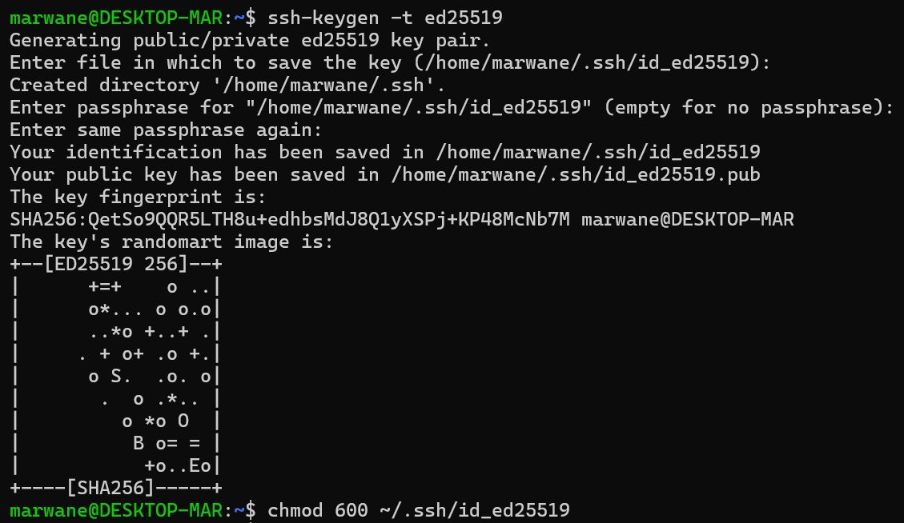](screenshots/ssh-keygen.png) | [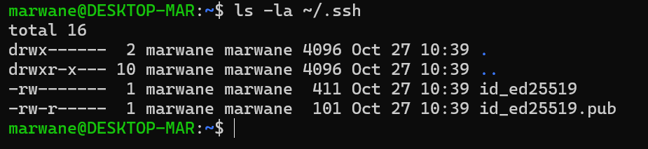](screenshots/ssh-permissions.png) |

| Clé publique ED25519 | Connexion SSH établie |
| :---: | :---: |
| [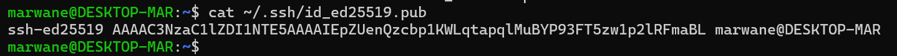](screenshots/ssh-cle-publique.png) | [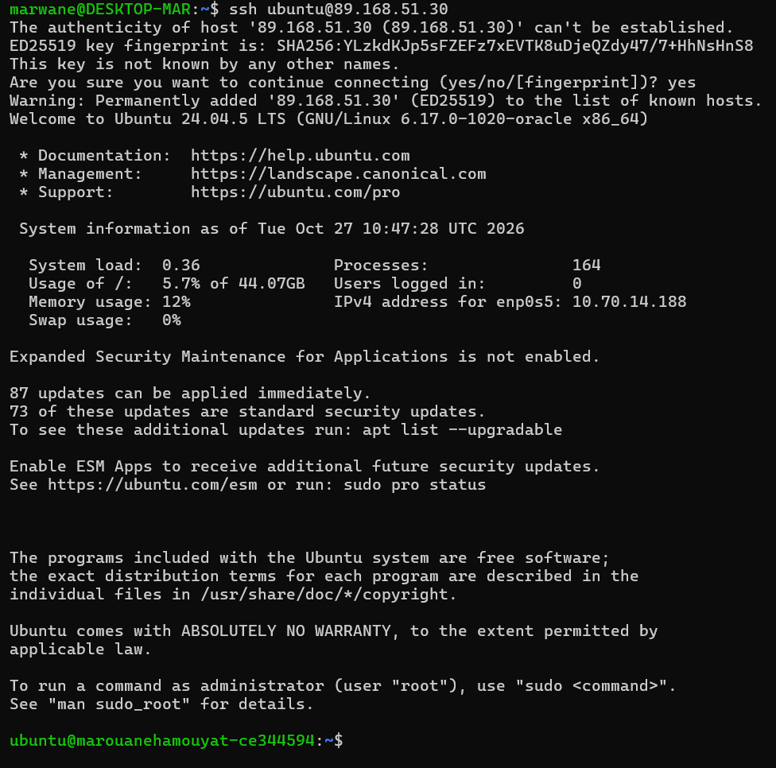](screenshots/ssh-connexion-etablie.png) |

---

### 2. Audit technique initial du serveur

| Rubrique | Commande utilisée | Valeur relevée |
| :--- | :--- | :--- |
| **Distribution et version** | `cat /etc/os-release` | Ubuntu 24.04.5 LTS |
| **Version du noyau** | `uname -a` | Linux 6.17.0-1020-oracle x86_64 |
| **Nom d'hôte** | `hostname` | `marouanehamouyat-ce344594` |
| **Processeurs logiques** | `nproc` | 2 vCPU |
| **Mémoire RAM totale** | `free -h` | 3.8 GiB |
| **Capacité disque `/`** | `df -h /` | 45 GB (Utilisé : 6 %) |
| **Durée de fonctionnement** | `uptime` | 16 min (Load average : 0.00) |
| **Utilisateur (UID / GID)** | `id` | `ubuntu` (UID : 1001, GID : 1001) |

[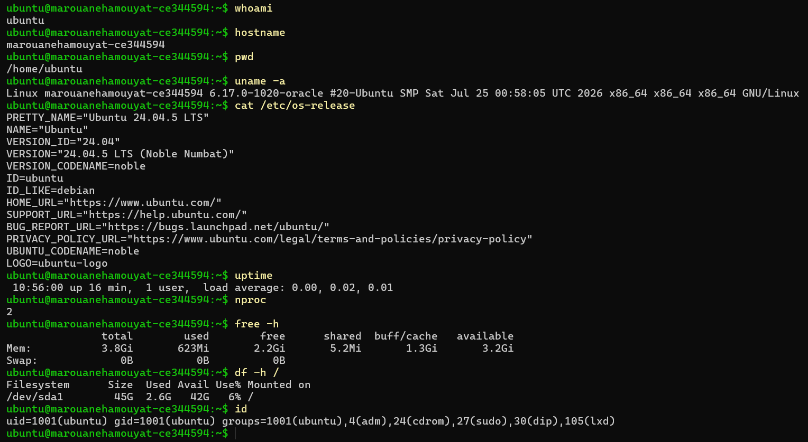](screenshots/audit-identite.png)

#### Réponses théoriques — audit système

* **Linux vs Ubuntu :** **Linux** désigne le noyau (*kernel*) qui pilote le matériel. **Ubuntu** est une distribution complète construite autour de ce noyau, avec des utilitaires, un installateur et le gestionnaire de paquets APT.
* **Fonction du noyau :** le noyau assure l'interface entre le matériel (CPU, RAM, disques, réseau) et les applications ; il gère les processus, la mémoire, les périphériques et les systèmes de fichiers.
* **Nom / UID / GID :** le **nom** (`ubuntu`) est l'identifiant lisible par l'humain ; l'**UID** (`1001`) est l'identifiant numérique unique du compte pour le noyau ; le **GID** (`1001`) identifie le groupe principal de l'utilisateur.

---

### 3. Norme FHS & Arborescence Métier

Création de la structure métier pour les départements de l'entreprise :

```bash
mkdir -p entreprise/{informatique,rh,finance,archives,rapports,scripts,projets}
```

| Répertoire | Rôle dans la norme FHS |
| :--- | :--- |
| `/` | Racine unique du système de fichiers Linux. |
| `/etc` | Fichiers de configuration du système et des services installés. |
| `/home` | Répertoires personnels des utilisateurs du système. |
| `/var` | Données variables (journaux/logs, spools, bases de données). |
| `/usr` | Programmes, utilitaires et bibliothèques partagées. |
| `/tmp` | Fichiers temporaires réinitialisés au redémarrage. |
| `/srv` | Données des services hébergés par le système (Web, FTP). |
| `/root` | Dossier personnel de l'administrateur système (root). |

| Création de l'arborescence | Exploration de la racine `/` |
| :---: | :---: |
| [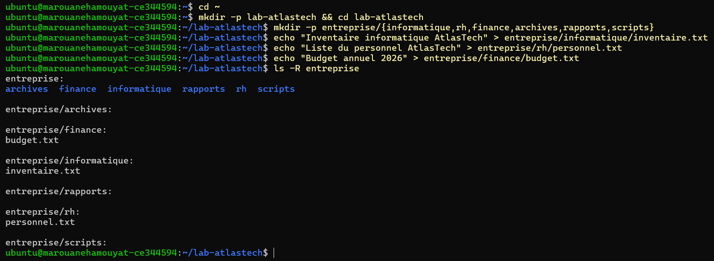](screenshots/arborescence-atlastech.png) | [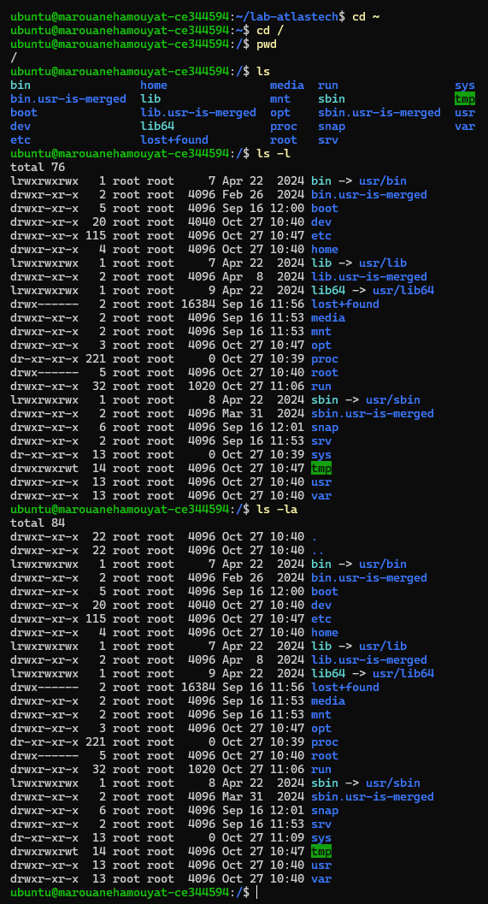](screenshots/exploration-racine.png) |

| Répertoire `/etc` | Répertoires FHS (`/home`, `/var`, `/srv`, `/tmp`, `/usr`) |
| :---: | :---: |
| [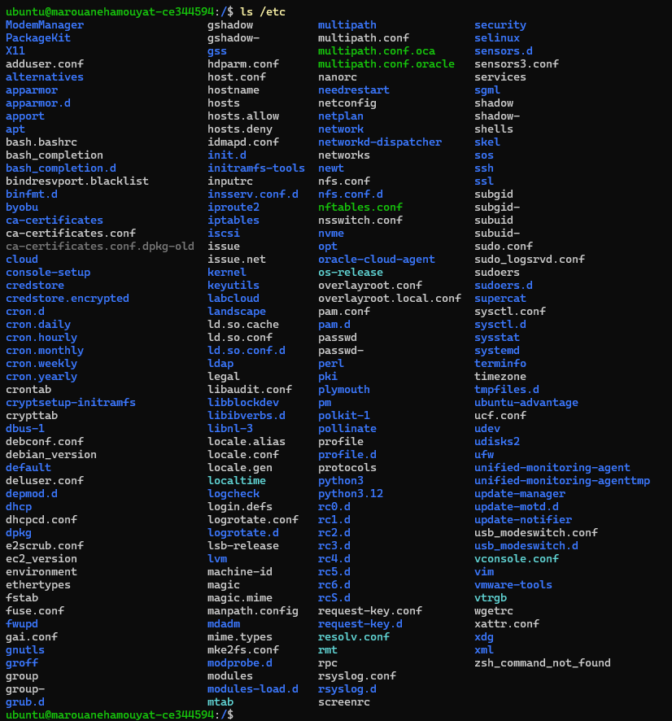](screenshots/etc-configuration.png) | [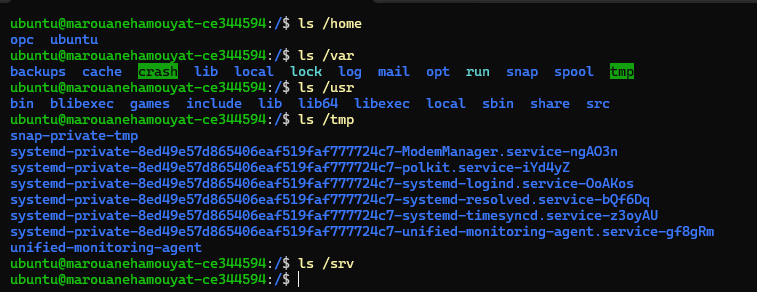](screenshots/fhs-repertoires.png) |

| Gestion et renommage de fichiers | Arborescence complète `entreprise/` |
| :---: | :---: |
| [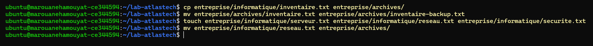](screenshots/gestion-fichiers.png) | [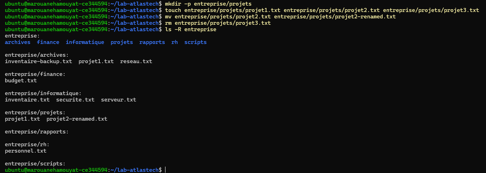](screenshots/projets-arborescence.png) |

#### Réponses théoriques — fichiers & arborescence

* **Chemin absolu vs relatif :** un chemin absolu part de la racine `/` (`/home/ubuntu/lab-atlastech`) ; un chemin relatif part du répertoire courant (`entreprise/finance`).
* **`mkdir -p` :** crée toute la hiérarchie de dossiers parents nécessaire et ne renvoie pas d'erreur si les dossiers existent déjà.
* **Opérateur `>` :** redirige la sortie standard vers un fichier en **écrasant** son contenu.
* **`cat` vs `ls` :** `cat` affiche le contenu d'un fichier ; `ls` liste le contenu d'un répertoire.
* **`find` vs `grep` :** `find` recherche des fichiers selon leurs métadonnées (nom, type, taille…) ; `grep` recherche une chaîne de caractères dans le contenu d'un fichier.
* **`>` vs `>>` :** `>` écrase le fichier cible ; `>>` ajoute le texte à la fin du fichier (*append*).
* **Pipe `|` :** redirige la sortie standard d'une commande vers l'entrée standard de la commande suivante.

Recherche et filtrage des journaux avec `find`, `grep` et `wc` :

```bash
find entreprise -type f
grep "ERROR" entreprise/rapports/systeme.log > entreprise/rapports/erreurs.txt
wc -l entreprise/rapports/erreurs.txt
```

[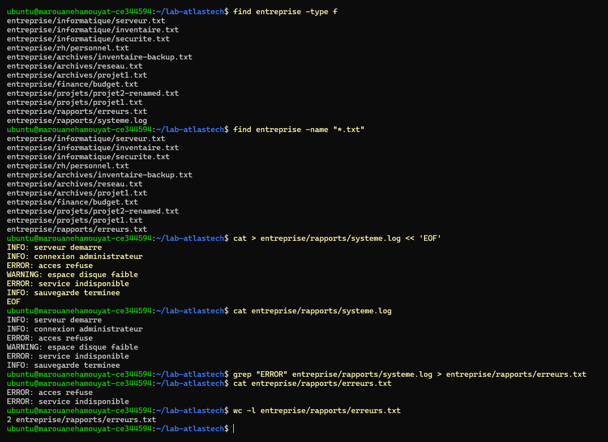](screenshots/find-grep-wc.png)

---

## 🔒 Matrice des Permissions & Sécurité

Application des restrictions d'accès sur les fichiers confidentiels :

| Mode octal | Notation symbolique | Signification |
| :---: | :---: | :--- |
| **`600`** | `-rw-------` | Lecture/Écriture pour le propriétaire uniquement. |
| **`640`** | `-rw-r-----` | Lecture/Écriture pour le propriétaire, lecture seule pour le groupe. |
| **`700`** | `drwx------` | Droits totaux pour le propriétaire, aucun accès pour le reste. |
| **`755`** | `drwxr-xr-x` | Droits totaux pour le propriétaire, lecture/traversée pour groupe et autres. |
| **`644`** | `-rw-r--r--` | Lecture/Écriture pour le propriétaire, lecture seule pour groupe et autres. |

**Masque `umask 077` :** empêche toute attribution automatique de droits au groupe et aux autres utilisateurs lors de la création de nouveaux fichiers ou répertoires.

> **Principe appliqué :** moindre privilège. Les données RH et Finance ne sont accessibles qu'aux comptes strictement autorisés.

[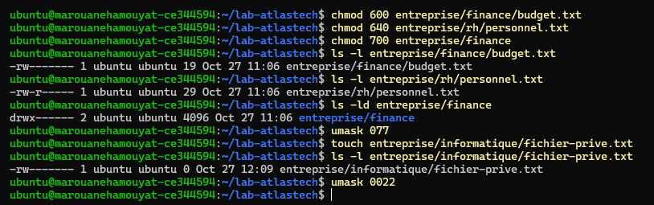](screenshots/permissions-matrice.png)

---

## 📦 Sauvegarde, Restauration & Incident

### 1. Options de l'outil d'archivage `tar`

| Option | Signification |
| :---: | :--- |
| **`-c`** | Créer une nouvelle archive (*create*). |
| **`-x`** | Extraire le contenu d'une archive (*extract*). |
| **`-t`** | Lister le contenu sans décompresser (*list*). |
| **`-z`** | Compresser avec `gzip`. |
| **`-f`** | Spécifier le nom du fichier d'archive (*file*). |
| **`-C`** | Spécifier le répertoire de destination pour l'extraction. |

**Fiabilité :** une sauvegarde ne peut pas être jugée fiable sans test de décompression et contrôle d'intégrité avec `diff -r`.

```bash
tar -czvf sauvegarde-entreprise.tar.gz entreprise
tar -tzvf sauvegarde-entreprise.tar.gz
mkdir -p test-restauration
tar -xzvf sauvegarde-entreprise.tar.gz -C test-restauration
diff -r entreprise test-restauration/entreprise
```

[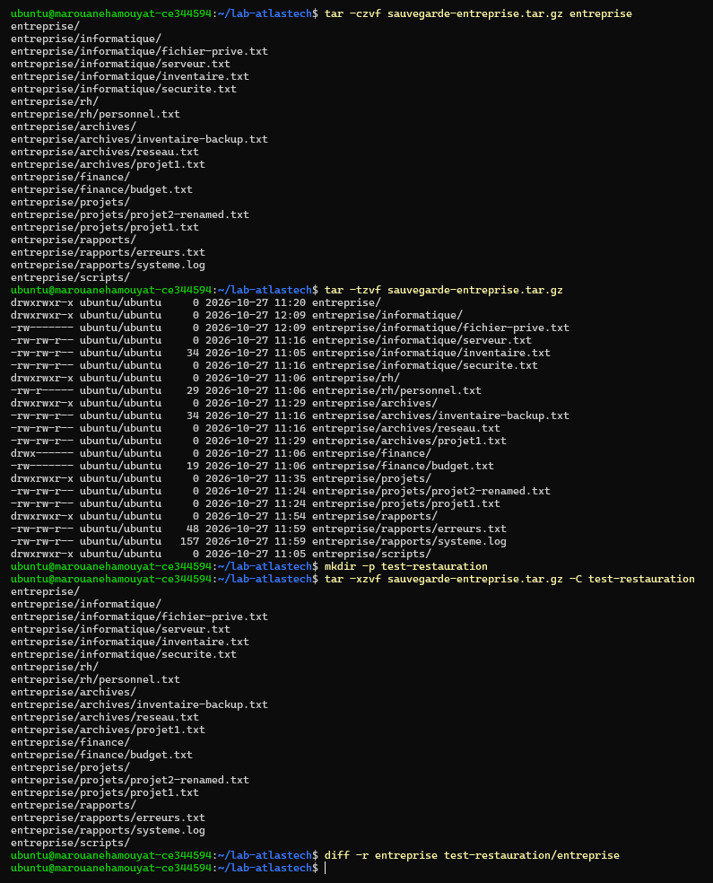](screenshots/test-restauration.png)

### 2. Rapport d'incident (résolution d'accès)

| Rubrique | Description / Solution |
| :--- | :--- |
| **Symptôme** | `-bash: entreprise/finance/budget.txt: Permission denied` |
| **Diagnostic** | Restitution de la commande `ls -l` montrant la suppression des droits d'écriture (`400`). |
| **Correction** | Réattribution des droits via `chmod 600 entreprise/finance/budget.txt`. |
| **Validation** | Écriture réussie confirmée avec `cat entreprise/finance/budget.txt`. |

[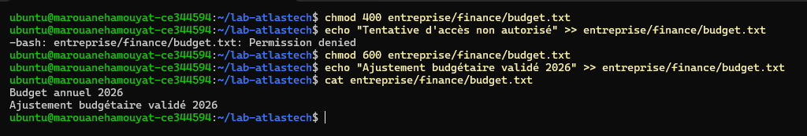](screenshots/permission-denied.png)

---

## 🛠 Scripts d'Automatisation

Le script `entreprise/scripts/maintenance.sh` extrait automatiquement les logs d'erreurs et génère une archive horodatée du système :

```bash
#!/bin/bash
echo "=== DEBUT DU SCRIPT DE MAINTENANCE ATLASTECH ==="
DATE=$(date +%Y-%m-%d_%H-%M)

grep "ERROR" entreprise/rapports/systeme.log > entreprise/rapports/erreurs_${DATE}.txt
tar -czf "sauvegarde_atlastech_${DATE}.tar.gz" entreprise

echo "=== MAINTENANCE TERMINEE AVEC SUCCES ==="
```

**Exécution :**

```bash
chmod +x entreprise/scripts/maintenance.sh
./entreprise/scripts/maintenance.sh
```

Le script produit deux artefacts :

* `entreprise/rapports/erreurs_<DATE>.txt` : uniquement les lignes `ERROR` du journal.
* `sauvegarde_atlastech_<DATE>.tar.gz` : archive compressée de tout le dossier `entreprise/`.

[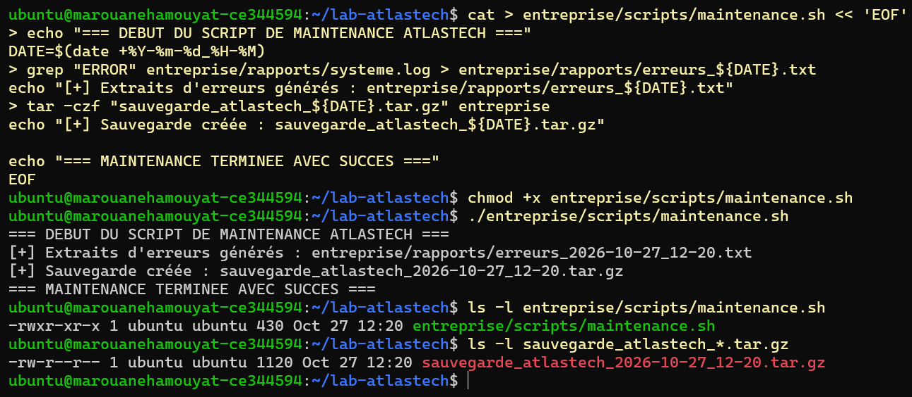](screenshots/script-maintenance.png)

---

## 📸 Galerie des Captures d'Écran

Toutes les captures sont stockées dans le dossier [`screenshots/`](screenshots/) et sont cliquables pour être affichées en pleine taille.

| # | Capture | Contenu documenté |
| :---: | :--- | :--- |
| 01 | [](screenshots/ssh-keygen.png) | Génération de la paire de clés ED25519. |
| 02 | [](screenshots/ssh-permissions.png) | Permissions `700/600` du dossier et de la clé privée. |
| 03 | [](screenshots/ssh-cle-publique.png) | Affichage de la clé publique à déployer. |
| 04 | [](screenshots/ssh-connexion-etablie.png) | Connexion SSH fonctionnelle au serveur. |
| 05 | [](screenshots/audit-identite.png) | Audit initial : `id`, UID/GID et système. |
| 06 | [](screenshots/arborescence-atlastech.png) | Création de l'arborescence métier. |
| 07 | [](screenshots/exploration-racine.png) | Exploration de la racine `/`. |
| 08 | [](screenshots/etc-configuration.png) | Contenu du répertoire `/etc`. |
| 09 | [](screenshots/fhs-repertoires.png) | Répertoires `/home`, `/var`, `/srv`, `/tmp`, `/usr`. |
| 10 | [](screenshots/gestion-fichiers.png) | Copie, renommage et création de fichiers. |
| 11 | [](screenshots/projets-arborescence.png) | Arborescence complète de `entreprise/`. |
| 12 | [](screenshots/permissions-matrice.png) | Application de `chmod` et de `umask 077`. |
| 13 | [](screenshots/find-grep-wc.png) | Recherche `find`, filtrage `grep`, comptage `wc -l`. |
| 14 | [](screenshots/test-restauration.png) | Archivage, extraction et vérification `diff -r`. |
| 15 | [](screenshots/permission-denied.png) | Incident `Permission denied` et correction. |
| 16 | [](screenshots/script-maintenance.png) | Exécution du script de maintenance. |

---

## 📑 Synthèse d'Administration

* **Responsabilités d'un administrateur Linux :** garantir la haute disponibilité, sécuriser les accès réseau, gérer les droits d'accès et planifier les sauvegardes.
* **Intérêt de SSH :** offre un canal d'administration hautement sécurisé et chiffré, contrairement aux protocoles en clair comme Telnet.
* **Importance de la norme FHS :** garantit la standardisation de l'arborescence sur l'ensemble des distributions Linux, ce qui facilite la localisation des configurations (`/etc`), des journaux (`/var/log`) et des exécutables (`/usr/bin`).
* **Protection des permissions :** impose le respect strict du principe du moindre privilège pour éviter les fuites ou les altérations de données.
* **Diagnostic en CLI :** repose sur une analyse méthodique des journaux système, des permissions (`ls -l`, `stat`) et des métadonnées des fichiers.

---

<div align="center">

**Projet réalisé par Marwane Hamouyat — ENSET Mohammedia — LP ACSRC 2026–2027**

*Administration Linux · Ubuntu 24.04 LTS · SSH ED25519 · FHS · Permissions · tar/gzip · Bash*

</div>
